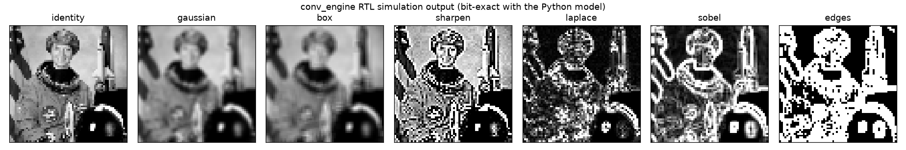

# Streaming Convolution Engine: RTL to GDS

A hand-designed, line-buffered 3×3 streaming convolution engine (Sobel / Gaussian) with AXI4-Stream and AXI4-Lite interfaces. It is verified against a bit-exact Python golden model, demonstrated live on HDMI video on a PYNQ-Z2 FPGA, and taken through an open-source ASIC flow to a GDS layout for a PPA study.

Builds on [Pynq-Z2_VideoP](https://github.com/ydss0857/Pynq-Z2_VideoP), the HDMI grayscale pipeline that serves as the FPGA test harness.

## Layout

| Path | Contents |
|---|---|
| `rtl/` | Technology-independent Verilog for the convolution engine |
| `tb/` | cocotb testbenches |
| `model/` | Python golden model (fixed-point, bit-exact) |
| `formal/` | SymbiYosys formal proofs (AXI-Stream properties) |
| `fpga/` | Vivado project for PYNQ-Z2 (HDMI in → engine → HDMI out) |
| `asic/` | LibreLane (sky130) flow configuration, run scripts and PPA results |
| `docs/` | Architecture diagrams and the technical report |



## Status

| | |
|---|---|
| FPGA (xc7z020-1, out of context) | 898 LUTs, 1,012 FFs, 1 BRAM36, 18 DSP48s, meets 150 MHz (+0.81 ns) |
| ASIC (sky130A hd, `MAX_WIDTH` 128) | 0.468 mm², 0 DRC / 0 LVS, hold clean at all corners, 80 MHz at typical (Fmax ≈ 112 MHz), ≈ 68 MHz at the slow corner; 28 mW |
| Simulation | 32 cocotb tests on Icarus and Verilator; 1.89 M output pixels bit-exact with the Python model, including two 1280×720 frames |
| Formal | Unbounded protocol proofs for the skid buffer, AXI4-Lite registers and window generator; bounded proof of window contents |
| Coverage | 100 % line, branch, expression and toggle (82 documented waivers) |
| Mutation testing | 14 injected bugs, all caught |

Architecture, bit widths, register map: [docs/spec.md](docs/spec.md). Verification details and limitations: [docs/verification.md](docs/verification.md). ASIC implementation, timing closure and PPA study: [docs/asic.md](docs/asic.md).

## RTL

| File | Block |
|---|---|
| `rtl/conv_engine.v` | Top level: AXI4-Stream video in/out, AXI4-Lite control |
| `rtl/axis_skid.v` | Two-entry skid buffer (registered `tready`, full throughput) |
| `rtl/luma_axis.v` | RGB → 8-bit luma, 2-stage pipeline |
| `rtl/conv_window.v`, `rtl/line_ram.v` | Line buffers + 3×3 window generator, edge replication, framing checks, precomputed position flags |
| `rtl/conv_datapath.v`, `rtl/mul_u8s8.v` | Two 3×3 MAC lanes, combine / saturate / threshold; free-running 8-stage pipeline with a credit-based output FIFO |
| `rtl/conv_regs.v` | AXI4-Lite register block |

## ASIC


The same RTL through LibreLane on SkyWater sky130 ([docs/asic.md](docs/asic.md)):

- **Timing closure in seven runs.** Three RTL changes came out of it: local skid buffers, precomputed counter flags, and a credit-based datapath in place of a 650-flop shared clock enable. There was also one constraint fix, a realistic minimum input delay at the macro boundary. Hold is now clean at every corner, and the design passes LibreLane's sky130 sign-off.
- **Line-buffer width sweep (64–512):** std-cell area ≈ 166,200 µm² + 917 µm² per pixel of width (0.2 % fit). Flip-flop line buffers would be 88 % of the area at 720p; sky130's SRAM macros win above ≈ 220–440 pixels.
- **Cell libraries:** `sky130_fd_sc_hs` reaches 75 MHz at the slow corner (enough for 720p60), at +33 % area and 2.2× power.

## Running the tests (WSL / Linux)

```bash
source ~/venvs/sce/bin/activate
cd tb/top && make            # or tb/skid, tb/window, tb/datapath, tb/regs; SIM=verilator also works
cd model && python -m pytest
cd tb && ./run_coverage.sh   # all testbenches under Verilator + coverage report
cd formal/skid && sby -f skid.sby   # also formal/regs, formal/window
```

Requires Icarus Verilog 12+ and Python with `cocotb`, `numpy`, `scipy`, `scikit-image`, `matplotlib`. Coverage needs Verilator ≥ 5.036; formal needs Yosys and SymbiYosys. Full tool versions are in [docs/verification.md](docs/verification.md#7-reproducing).

## Plan

| Phase | Work |
|---|---|
| 0 ✅ | Tool setup; fix backpressure in `grayscale_axis`; first cocotb testbench |
| 1 ✅ | Python golden model, fixed-point analysis, block diagram |
| 2 ✅ | RTL: line buffers, 3×3 window, convolution datapath, skid buffers, AXI4-Lite registers |
| 3 ✅ | Verification: bit-exact image tests, randomized backpressure, formal proofs, coverage |
| 4 | FPGA integration and live HDMI demo on PYNQ-Z2 |
| 5 ✅ | ASIC flow (LibreLane, sky130): GDS, timing closure, PPA study, FPGA vs ASIC comparison |
| 6 | Write-up and technical report |

## FPGA Build Requirements

- Vivado 2023.2
- [Digilent vivado-library](https://github.com/Digilent/vivado-library) at `C:\xilinx_ip\vivado-library` (provides `dvi2rgb` / `rgb2dvi`)
