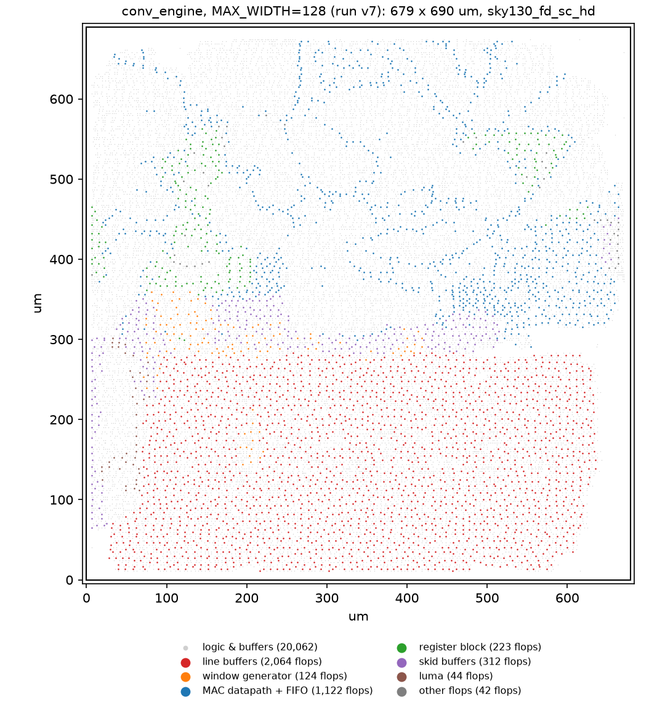

# ASIC Implementation: RTL to GDS on SkyWater sky130

The same RTL that runs on the FPGA, hardened as a macro with the open-source [LibreLane](https://github.com/librelane/librelane) 3.0.16 flow (Yosys, OpenROAD, Magic, KLayout, Netgen) on the SkyWater sky130A process with the `sky130_fd_sc_hd` standard-cell library.

## 1. Result

Baseline run `w128_80mhz_v7` (`MAX_WIDTH` = 128, 80 MHz target):

| | |
|---|---|
| Die / std-cell area | **0.468 mm²** (679 × 690 µm) / 283,407 µm² at 50 % utilisation |
| Cells / flip-flops | 30,342 standard cells, 3,931 flip-flops |
| Physical sign-off | **0 Magic DRC, 0 KLayout DRC, 0 LVS** errors, 0 antenna violations |
| Hold | Clean at every corner (worst +0.11 ns, ff) |
| Setup, typical (tt, 25 °C, 1.80 V) | **+3.57 ns at 80 MHz** → Fmax ≈ 112 MHz |
| Setup, fast (ff, −40 °C, 1.95 V) | +5.95 ns |
| Setup, slow (ss, 100 °C, 1.60 V) | −2.27 ns (TNS −19 ns) → Fmax ≈ 68 MHz |
| Power (typical corner, 80 MHz, default activity) | 28.2 mW |
| Sign-off status | **Passes LibreLane's sky130 sign-off** (setup checked at the typical corner, hold at all corners). Does not meet the stricter all-corner 80 MHz target set in this project; see §3. |



*Every flip-flop of the routed block, coloured by RTL block (via the RTL names preserved on their output nets; generated by `asic/placement_map.py`). The two flip-flop line buffers fill the bottom 40 % of the die.*

## 2. Setup

| Item | Choice | Why |
|---|---|---|
| Flow | LibreLane 3.0.16 via Nix, in WSL2 | Pinned, reproducible tool versions |
| PDK / library | sky130A, `sky130_fd_sc_hd` (high density) | Most mature open PDK; `_hs` compared in §5 |
| Top level | `conv_engine`, hardened as a macro (no pad ring) | Same RTL as the FPGA build |
| `MAX_WIDTH` | 128 (FPGA build: 2048) | In standard cells every line-buffer bit is a flip-flop; see §4 |
| Clock target | 12.5 ns (80 MHz) | Requirement: 720p60 needs 74.25 MHz (≈ 74.4 MHz with the engine's flush cycles) |
| Constraints | [`asic/conv_engine/conv_engine.sdc`](../asic/conv_engine/conv_engine.sdc) | LibreLane's default SDC plus a realistic minimum input delay (§3, v5) |
| Config | [`asic/conv_engine/config.yaml`](../asic/conv_engine/config.yaml) | Every non-default setting is commented with the run that motivated it |
| Runs | [`asic/run_flow.sh`](../asic/run_flow.sh) `<tag> [-c KEY=VALUE]` | Linux-side work directory, 90-minute cap, trimmed results to `asic/results/<tag>/` |

## 3. Timing closure: seven runs

| Run | Change | Setup WNS ss | Setup TNS ss | Hold WNS ss | Finding |
|---|---|---:|---:|---:|---|
| v1 | First run, 100 MHz | −2.60 | −3,054 | −0.29 | Physically clean (0 DRC/LVS); critical path is the pipeline **stall enable**, which chained combinationally through every block and fanned out to thousands of flops |
| v2 | Skid buffers between blocks (RTL) | −2.31 | −1,467 | −0.40 | TNS halved, but the worst path held four `clkdlybuf4s25` **delay cells** (≈1.4 ns each) used by the resizer as ordinary buffers |
| v3 | Exclude `clkdlybuf4s*` from repair | −2.67 | −451 | −0.51 | Typical-corner Fmax 149 MHz; repair now builds long chains of `buf_1` sized for typical silicon |
| v4 | Raise repair slew/cap margins to 50/40 % | — | — | — | **Abandoned**: ~18,000 nets flagged, repair ran > 2 h and exhausted WSL memory. Lesson: change one knob at a time, in small steps |
| v4b | Requirement-based target: 80 MHz | −1.58 | −42 | −0.20 | Worst path now a ~20-level comparator chain in the window generator; hold fails only on input ports |
| v5 | Precomputed counter flags (RTL); realistic min input delay (SDC) | −3.54 | −391 | **+0.84** | **Hold closed at all corners.** Setup now limited by the datapath's single stall enable driving ~650 flops |
| v6 | Free-running datapath with credit-based output FIFO (RTL) | −2.32 | −45 | +0.69 | Enable fanout gone; remaining paths are long buffered nets with ~9,000 slew violations at ss |
| v7 | Place and repair at the ss corner; 50 % utilisation | −2.27 | **−19** | +0.85 | Die 0.582 → 0.468 mm²; ss slew violations persist (they come from wire length, see below) |

Full metrics: `python3 asic/compare.py` (results in [`asic/results/`](../asic/results)).

**What closed, and how:**
- **Hold:** at the macro boundary the default SDC measures input delay from an ideal clock edge, while inside the macro the clock arrives ~2.9 ns later at ss, so every input-to-flop path "failed" hold. In an SoC, the logic driving these pins sits on the same balanced clock tree. [`conv_engine.sdc`](../asic/conv_engine/conv_engine.sdc) models that by adding a 1 ns external clock latency to the *minimum* input delay only; the setup (max) constraints are unchanged.
- **Logic depth:** three RTL changes, each verified by the full simulation, formal and coverage suites before the next ASIC run:
  1. internal skid buffers, so no ready chain spans more than one block;
  2. down-counters with registered one-bit flags in place of 12-bit comparators;
  3. a free-running datapath with credit-based flow control in place of a 650-flop shared clock enable.

  The last two also *improved* the FPGA build (+0.62 → +0.81 ns slack at 150 MHz) and made the window generator's unbounded formal proof ~20× faster (3 min 55 s → 11 s).

**What did not close:** setup at the slow corner. The placement map shows why: the line-buffer array spans ~600 × 280 µm, and the window generator's read address and enables must reach all of it every cycle. At ss (100 °C, 1.60 V) those long nets have 2+ ns transitions, which no amount of buffer repair recovered (v3–v7). LibreLane's own sky130 sign-off checks setup at the typical corner only (`TIMING_VIOLATION_CORNERS = *tt*`), which this design passes with 3.6 ns to spare; the all-corner target was this project's stricter choice.

**Lessons:**
- **FPGA-friendly is not ASIC-friendly.** A shared clock enable costs nothing on an FPGA (every flop has a CE pin and enables have dedicated routing), but in standard cells it is a high-fanout net plus a mux per flop.
- **Know what the tool optimises against.** By default LibreLane places, repairs and builds the clock tree at the typical corner only; slow-corner problems are invisible until sign-off.
- **Set targets from requirements.** 80 MHz came from 720p60, not from "as fast as possible".
- **Change one variable per run.**

## 4. PPA study: line-buffer width

Same configuration as the baseline; only `MAX_WIDTH` changes.

| `MAX_WIDTH` | 64 | 128 | 256 | 512 |
|---|---:|---:|---:|---:|
| Std-cell area (µm²) | 224,438 | 283,407 | 402,292 | 635,422 |
| Die area (mm²) | 0.382 | 0.468 | 0.638 | 0.975 |
| Flip-flops | 2,905 | 3,931 | 5,981 | 10,079 |
| Power, tt @ 80 MHz (mW) | 22.0 | 28.2 | 43.0 | 67.5 |
| Fmax ss / tt (MHz) | 74 / 122 | 68 / 112 | 65 / 127 | 58 / 112 |
| Setup TNS ss (ns) | −7 | −19 | −52 | −2,431 |
| DRC / LVS errors | 0 / 0 | 0 / 0 | 0 / 0 | 0 / 0 |

**Linear fit over all four points** (largest residual 0.2 % of area):
- std-cell area ≈ **166,200 µm² + 917 µm² per pixel of width**; with 16 stored bits per pixel (two lines × 8 bits) that is ≈ **57 µm² per stored bit**, including its flop, write-enable mux, read mux and buffering;
- power ≈ **15.7 mW + 0.102 mW per pixel of width**.

| Width | Line buffers (fit) | Share of std-cell area |
|---|---:|---:|
| 128 | 0.12 mm² | 41 % |
| 1280 (720p) | 1.17 mm² | 88 % |
| 2048 (FPGA build) | 1.88 mm² | 92 % |

Wider line buffers are also slower at ss (74 → 68 → 65 → 58 MHz from 64 to 512), with the slow-corner TNS growing from −7 ns to −2,431 ns: the read multiplexers get deeper and the array gets physically bigger, which is consistent with the long-wire diagnosis in §3. Only the typical corner stays flat (~112–127 MHz).

**Flip-flops versus SRAM.** sky130 ships OpenRAM macros with one read/write port plus one read port, which is exactly what a line buffer needs (one write and one read per pixel):

| Macro | Footprint | Pixels per line | Two lines |
|---|---|---:|---:|
| `sky130_sram_1kbyte_1rw1r_8x1024_8` | 455 × 446 µm = 0.203 mm² | 1,024 | 0.407 mm² |
| `sky130_sram_2kbyte_1rw1r_32x512_8` (4 pixels per 32-bit word) | 683 × 417 µm = 0.285 mm² | 2,048 | 0.569 mm² |

Against the fit above, two 1 KB macros (0.407 mm²) equal the flip-flop *cell* area at ≈ **440 pixels** of width, and the *die* area (cells at 50 % utilisation) at ≈ **220 pixels**. At 720p (1280) the 2 KB pair needs 0.57 mm² against ≈ 1.2 mm² of flip-flop cells (≈ 2.3 mm² of die); at 2048, 0.57 against ≈ 1.9 (≈ 3.8). The macro would also remove the long read-address wires that limit ss timing. It was not implemented here: the PDK ships only a typical-corner timing model for these macros, so an SRAM-based block could not be signed off at the slow and fast corners.

## 5. Cell library: high density versus high speed

Same RTL and settings as the baseline, with the `sky130_fd_sc_hs` (high-speed) library instead of `_hd` (run `hs_w128_80mhz`):

| | `sky130_fd_sc_hd` (v7) | `sky130_fd_sc_hs` | Change |
|---|---:|---:|---:|
| Std-cell area (µm²) | 283,407 | 378,300 | +33 % |
| Die area (mm²) | 0.468 | 0.591 | +26 % |
| Power, tt @ 80 MHz (mW) | 28.2 | 62.7 | ×2.2 |
| Setup WNS ss (ns) | −2.27 | −0.75 | |
| **Fmax ss (MHz)** | 68 | **75** | +10 % |
| Fmax tt (MHz) | 112 | 128 | +14 % |
| Max-slew violations | 9,184 | 3,602 | −61 % |
| DRC / LVS errors | 0 / 0 | 0 / 0 | |

The high-speed cells drive long nets harder (61 % fewer slew violations), which lifts the slow-corner Fmax to **75 MHz: enough for 720p60 (74.25 MHz) even on slow silicon at 100 °C**, though still 0.75 ns short of the 80 MHz target. The price is a third more area and more than twice the power. For a video block that must work at every corner, `hs` meets the real requirement; for a power-sensitive part, `hd` with SRAM line buffers (§4) would be the better direction.

## 6. FPGA versus ASIC

The same RTL (`MAX_WIDTH` 2048 on the FPGA, 128 in silicon):

| | FPGA: Zynq-7020 (xc7z020-1), routed out of context | ASIC: sky130A hd, baseline v7 |
|---|---|---|
| Line buffers | 1 BRAM36 (any width up to 2048) | 2,064 flip-flops at width 128 (≈ 41 % of cell area) |
| Multipliers | 18 DSP48 | 18 multipliers in standard cells |
| Logic | 898 LUTs, 1,012 FFs | 30,342 cells, 3,931 FFs |
| Size | ~1.7 % of the device | 0.468 mm² |
| Clock | **150 MHz** met (+0.81 ns) | 80 MHz met at tt (Fmax ≈ 112 MHz); ≈ 68 MHz at ss |
| What limits it | Nothing yet at 150 MHz | Long nets to the flip-flop line-buffer array at the slow corner |

The FPGA is *faster* here because its hard blocks (BRAM, DSP48, per-flop clock enables, fast global routing) are exactly the structures this design leans on, whereas sky130 is an older 130 nm node built only from standard cells. The ASIC gains, on the other hand, would come from implementing the line buffers in SRAM and from a smaller node.

## 7. Limitations

- **Macro only**: no pad ring, no chip-level integration or tape-out.
- **Fmax figures are estimates** derived from setup slack at the run's target clock (`1 / (period − WNS)`); the tools optimise less once a target is met, so these are lower bounds on what the design could reach with a tighter target. Runs v1–v3 used 100 MHz, later runs 80 MHz.
- **Power** is OpenROAD's estimate at the typical corner with default switching activity (no simulation-based activity file), at each run's clock frequency.
- **One placement per configuration**; results vary by a few percent with placement randomness (compare v5 and v6 at the typical corner).
- **SRAM line buffers are estimated from the macro's datasheet values**, not implemented.

## 8. Reproducing

In WSL / Linux with Nix and LibreLane 3.0.16 installed (see the [LibreLane install guide](https://librelane.readthedocs.io/en/latest/installation/nix_installation/installation_win.html)):

```bash
asic/run_flow.sh w128_80mhz_v7                                   # baseline
asic/run_flow.sh w256_80mhz -c SYNTH_PARAMETERS=MAX_WIDTH=256,AW=8
asic/run_flow.sh hs_w128_80mhz --scl sky130_fd_sc_hs -c "EXTRA_EXCLUDED_CELLS=sky130_fd_sc_hs__clkdlybuf4s*"
python3 asic/compare.py w64_80mhz w128_80mhz_v7 w256_80mhz      # compare runs
python3 asic/placement_map.py <run>/final/def/conv_engine.def out.png
```
