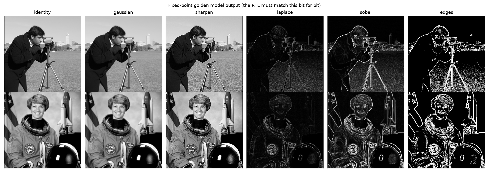

# Streaming Convolution Engine: Architecture Spec (Phase 1)

Status: Phase 1 complete. Confirmed decisions: programmable two-lane engine; FPGA demo at 720p60 with `MAX_WIDTH` = 2048. The bit-exact reference is [`model/conv_model.py`](../model/conv_model.py); where this document and the model disagree, the model wins and this document gets fixed.

## 1. What it does

A programmable 3×3 image filter that sits in an AXI4-Stream video pipeline. It takes RGB pixels, converts them to luma, filters the luma with one or two 3×3 kernels, and outputs the result as gray RGB. One configuration covers blur, sharpen, Laplacian, Sobel edge magnitude, and thresholded edge maps.



## 2. Interfaces

| Port | Protocol | Notes |
|---|---|---|
| `s_axis_video` | AXI4-Stream, 24-bit `tdata`, `tuser` = start of frame, `tlast` = end of line | `{R[23:16], B[15:8], G[7:0]}` (Xilinx video RGB order) |
| `m_axis_video` | AXI4-Stream, same format | Output `{Y, Y, Y}`; same pixel count as the input frame |
| `s_axi_ctrl` | AXI4-Lite, 32-bit | Registers in §6 |
| `aclk`, `aresetn` | Single clock domain | Target 150 MHz on Zynq-7020 (1080p60 needs 148.5 MHz; 720p60 needs 74.25 MHz) |

## 3. Datapath

```
             ┌──────┐   ┌───────────────┐   ┌──────────┐   ┌─────────────┐   ┌─────────────┐   ┌──────┐
s_axis ──►───┤ skid ├──►┤ luma          ├──►┤ line buf ├──►┤ 3×3 window  ├──►┤ lane K0 MAC ├─┐ │      │
             │ buf  │   │ 77R+150G+29B  │   │ 2 × W×8b │   │ + edge      │   │ (9 mult)    │ ├►┤combine├──►┐
             └──────┘   │ >> 8          │   │ (BRAM /  │   │ replicate   ├──►┤ lane K1 MAC ├─┘ │abs/sat│   │
                        └───────────────┘   │  SRAM)   │   └─────────────┘   │ (9 mult)    │   │thresh │   │
                                            └──────────┘    row/col counters └─────────────┘   └──────┘   │
                                                                                                          ▼
                                                                         m_axis ◄── skid buf ◄── {Y,Y,Y} + tuser/tlast
```

1. **Skid buffers** on both stream ports, so `tready` is registered, backpressure is handled correctly (the Phase 0 bug class), and full throughput is kept.
2. **Luma:** the same formula as `grayscale_axis`, 8-bit result.
3. **Line buffers:** two memories of `MAX_WIDTH × 8 bit` holding the previous two rows. FPGA: inferred block RAM. ASIC: flip-flops or an SRAM macro (a PPA study variable, §8).
4. **Window generator:** a 3×3 register array shifted every pixel, plus row/column counters that select replicated pixels at the image borders.
5. **Two MAC lanes:** each multiplies 9 signed coefficients by 9 unsigned pixels and sums the products, followed by a rounded arithmetic right shift.
6. **Combine:** `LANE0`, `ABS0` = |lane0|, or `MAG` = |lane0| + |lane1|. Then saturate to 0–255, then optionally threshold to 0 or 255.

## 4. Fixed-point formats

| Signal | Format | Why |
|---|---|---|
| Pixel / luma | u8 | Video standard |
| Coefficient | s8, range −128…127 | Covers every preset with room for custom kernels |
| Product | s17 | u8 × s8 |
| Accumulator | **s20** | Worst case 9 × 128 × 255 = 293,760 < 2¹⁹ |
| Shift | 0–15, round half up: `(acc + 2^(s−1)) >>> s` | Divide-by-power-of-two normalisation with no divider |
| Output | u8, saturated | Then optional threshold |

**Measured** (`model/analyze.py`, 512×512 camera and astronaut images):

| Preset | Max error vs float | Mean error | PSNR | Saturated pixels | Accumulator bits used |
|---|---|---|---|---|---|
| gaussian | 0.50 LSB | 0.25 LSB | 59 dB | 0 % | 13 / 20 |
| box | 0.50 LSB | 0.25 LSB | 59 dB | 0 % | 15 / 20 |
| sharpen | 0 | 0 | exact | 5.5–7.7 % | 11 / 20 |
| laplace | 0 | 0 | exact | ≤ 0.1 % | 11 / 20 |
| sobel (L1) | 75 LSB | 5–6.5 LSB | 26–28 dB | 1.4–1.9 % | 11 / 20 |

Findings:

- **Rounding error never exceeds half an LSB**, the theoretical minimum for an 8-bit output. The fixed-point choice costs nothing visible.
- **The luma approximation** is off by at most 1 LSB from exact BT.601 (mean −0.37 LSB).
- **All Sobel error comes from using |Gx| + |Gy| instead of √(Gx² + Gy²)**, not from bit widths. L1 overestimates diagonal edges by up to 41 % (measured mean 26 % on edges). It avoids two squarers and a square root, which is the standard hardware trade-off. A cheaper-but-closer option is listed in §8.
- **Real images use at most 15 of the 20 accumulator bits.** The full 20 bits are kept so arbitrary programmed kernels can't overflow; a fixed-kernel ASIC variant could drop to about 16 (§8).

## 5. Border handling, latency, and flushing

Out-of-image neighbours are **replicated from the nearest edge pixel**, matching the model.

The output pixel at (row r, column c) needs input pixel (r+1, c+1). So the engine runs **one row plus one pixel behind** its input:

- **End of each row:** the last output pixel of row r needs one extra cycle with no new input (the replicated right edge). The engine inserts one **flush cycle**, holding `s_axis_tready` low.
- **End of the frame:** the last output row needs a full row of flush cycles (the replicated bottom edge).

Cost: (W+1)(H+1) cycles per frame instead of W·H. That's about 0.2 % more at 720p, and video blanking provides plenty of slack.

Frame size comes from the `WIDTH` and `HEIGHT` registers. Incoming `tlast` and `tuser` are checked against them, and a mismatch sets a sticky error bit, so a resolution change can't silently corrupt the output.

## 6. Register map (AXI4-Lite)

| Offset | Name | Bits | Description |
|---|---|---|---|
| 0x00 | CTRL | [0] `ENABLE` (0 = pass through luma unfiltered), [1] `THRESH_EN`, [3:2] `MODE` (0 LANE0, 1 ABS0, 2 MAG) | |
| 0x04 | STATUS | [0] `FRAME_ERR` (sticky, write 1 to clear) | |
| 0x08 | SHIFT | [3:0] `SHIFT0`, [11:8] `SHIFT1` | |
| 0x0C | THRESH | [7:0] | |
| 0x10 | WIDTH | [11:0] pixels per line | ≤ `MAX_WIDTH` |
| 0x14 | HEIGHT | [11:0] lines per frame | |
| 0x20–0x28 | K0_ROW0..2 | [7:0] col0, [15:8] col1, [23:16] col2, each s8 | |
| 0x30–0x38 | K1_ROW0..2 | same | |

All configuration is copied into shadow registers at **start of frame** (`tuser`), so software can change filters mid-frame without tearing.

## 7. Performance targets

| Item | Target |
|---|---|
| Throughput | 1 pixel/clock (minus flush cycles) |
| Clock | 150 MHz on xc7z020-1 |
| Max frame width | `MAX_WIDTH` parameter: 2048 on FPGA, smaller on ASIC (§8) |
| Latency | One line + about 6 pipeline stages |
| FPGA resources | Estimated 2 BRAM18 for line buffers; ≤ 18 DSP48s (or LUT multipliers) |

## 8. Open questions and PPA study variables (Phase 5)

These are deliberately left as parameters so the ASIC flow can measure their cost:

1. **Line buffer storage:** flip-flops vs SRAM macro, and `MAX_WIDTH` (640 vs 1280 vs 2048). Expected to dominate ASIC area.
2. **Programmable vs fixed kernels:** 18 general multipliers vs hard-wired shift-and-add for one preset.
3. **Gradient magnitude:** L1 (current), `max + min/2` (about 12 % worst-case error, nearly the same cost), or exact L2 (squarers plus a square root).
4. **Accumulator width:** 20 bits (safe for any kernel) vs about 16 for fixed kernels.
5. **Pipeline depth:** MAC tree registered every adder level vs every two levels. Trades Fmax against flip-flop count and power.

## 9. Verification plan (Phase 3 preview)

- cocotb: random images, random sizes, and random backpressure; compare every pixel with `conv_model.process_frame`.
- Directed tests: 1×1, 1×N, and N×1 frames; maximum width; all presets; register changes mid-frame.
- Formal (SymbiYosys): AXI4-Stream hold and no-drop properties on both ports, plus no accumulator overflow.
- Coverage: every MODE, border case, and flush path is hit.
